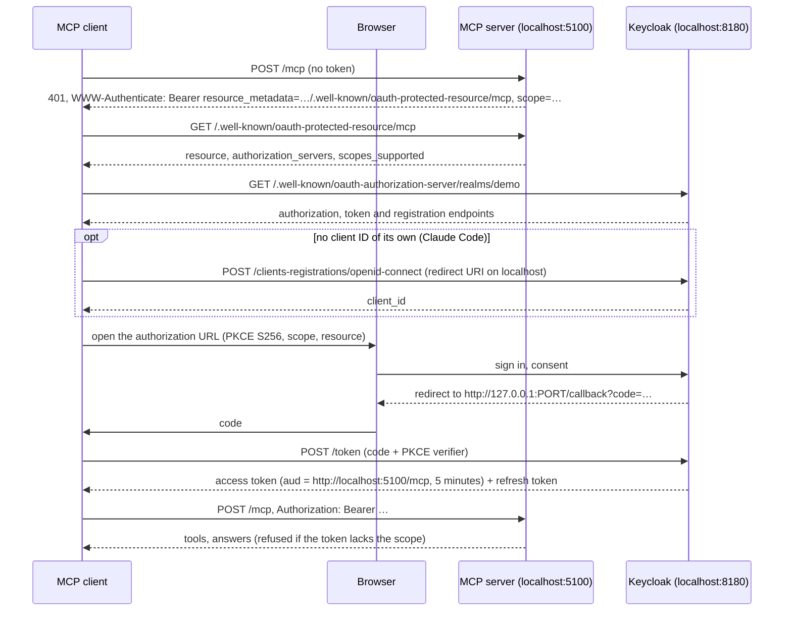

# MCP server with OAuth sign-in: ASP.NET Core and Keycloak

An [MCP](https://modelcontextprotocol.io) server in ASP.NET Core that only signed-in users can use, with [Keycloak](https://www.keycloak.org) as the OAuth authorization server. This is the example for a [step-by-step article](https://gergodrazsdik.com/blog/mcp-server-oauth-aspnet-core-keycloak). Each step is a commit and a tag (`step-01` … `step-10`), so you can follow along or compare your code with any step.

What it shows:

- **The server stays a resource server.** JwtBearer validates Keycloak's access tokens. The [MCP C# SDK](https://github.com/modelcontextprotocol/csharp-sdk) sends the challenge and serves the protected resource metadata (RFC 9728), and that is how MCP clients find Keycloak.
- **Scopes decide what each tool does.** `list_notes` needs `notes:read`, `add_note` needs `notes:write`, and Keycloak grants each scope only to users holding the matching role.
- **Real clients sign in by themselves.** That covers a console client (browser sign-in, PKCE, loopback redirect), Claude Code (dynamic client registration) and VS Code (a pre-registered client).
- **Hardening.** The Origin check the MCP spec requires, CORS, rate limiting before authentication, short token lifetimes, refresh token rotation, and PKCE required for every client.



## Quick start

You need the [.NET 11 SDK](https://dotnet.microsoft.com/download/dotnet/11.0) and Podman or Docker with Compose. Ports 8180 (Keycloak) and 5100 (the MCP server) must be free.

```sh
podman compose up -d                         # or: docker compose up -d. Keycloak, with the demo realm imported
dotnet run --project src/McpAuth.Server      # the MCP server on http://localhost:5100/mcp
```

Keycloak takes about half a minute to start. Then, in another terminal:

```sh
dotnet run --project src/McpAuth.Client -- --add "Hello from the console"
```

A browser opens Keycloak's login page. Sign in as **alice** (password `alice`) and allow access. The client then prints who you are, what the token allows, and the notes, including yours. Run it again and sign in as **bob** (`bob`): Keycloak leaves `notes:write` out of his token, so `add_note` is refused. The same browser works, because the client asks for `offline_access` and Keycloak then keeps no browser session, so the next run shows the login page again. If Keycloak sends you straight back as alice instead (say you signed in to its account console in that browser), sign out at <http://localhost:8180/realms/demo/account>, or run with `--no-browser` and open the address in a private window. The client's options are `--read-only` (ask for `notes:read` only), `--add "<text>"` and `--no-browser` (print the sign-in address instead of opening it).

### Demo users (dev-only)

| User | Password | Roles | May |
| --- | --- | --- | --- |
| alice | `alice` | notes-reader, notes-writer | read and add notes |
| bob | `bob` | notes-reader | read notes |
| admin (master realm) | `admin` | Keycloak admin | <http://localhost:8180/admin> |

These passwords are public demo values, in [`keycloak/realm-demo.json`](keycloak/realm-demo.json) and [`compose.yaml`](compose.yaml). Never use this realm or these settings outside your own machine.

### Claude Code

```sh
claude mcp add --transport http mcpauth-notes http://localhost:5100/mcp
```

In Claude Code, run `/mcp`, choose `mcpauth-notes`, then **Authenticate**. Claude Code registers a client in Keycloak by itself, and you sign in and allow access in the browser.

### VS Code

Add the server to `.mcp.json` at the repository's root (VS Code 1.146 and Claude Code both read this file), or to `.vscode/mcp.json` with `"servers"` instead of `"mcpServers"` in older versions:

```json
{
  "mcpServers": {
    "mcpauth-notes": { "type": "http", "url": "http://localhost:5100/mcp" }
  }
}
```

VS Code's own client registration always includes a redirect URI on `vscode.dev`, and this realm only lets clients register with redirect URIs on localhost. So VS Code says "Dynamic Client Registration not supported" and asks for a client ID: choose **Copy URIs & Proceed** and enter **`mcpauth-vscode`**, a client the realm defines for it. Leave the client secret empty.

## Tests and screenshots

`tests/McpAuth.Screens` (TUnit and Playwright) runs against the running stack. It signs in through Keycloak's real login and consent pages with the console client, as alice, bob and read-only alice, and checks what the tools answer. It also checks the challenge, the metadata, the Origin check and CORS (a page on `http://localhost:6274` calls the server from a real browser, so stop the MCP Inspector first), and saves screenshots of the sign-in and the admin console. Install the browser once, then run the tests:

```sh
dotnet build
pwsh artifacts/bin/McpAuth.Screens/debug/playwright.ps1 install chromium
dotnet test --project tests/McpAuth.Screens
```

The screenshots go to `notes/screenshots/`.

## The steps

| Tag | Step |
| --- | --- |
| [`step-01`](../../tree/step-01) | An MCP server with one tool (Streamable HTTP, stateless), and a console client |
| [`step-02`](../../tree/step-02) | Keycloak with a seeded demo realm: users, roles, the notes scopes, an audience mapper |
| [`step-03`](../../tree/step-03) | Require a bearer token: JwtBearer validates, the MCP SDK sends the challenge |
| [`step-04`](../../tree/step-04) | The protected resource metadata names the scopes |
| [`step-05`](../../tree/step-05) | The console client signs in through the browser (PKCE, loopback redirect) |
| [`step-06`](../../tree/step-06) | Each tool checks the token's scopes; `whoami` shows them |
| [`step-07`](../../tree/step-07) | Real clients: dynamic client registration for Claude Code, a fixed client for VS Code |
| [`step-08`](../../tree/step-08) | Hardening: Origin, CORS, rate limiting, clock skew, `scope` and `error="invalid_token"` in the challenge, refresh token rotation, PKCE for every client |
| [`step-09`](../../tree/step-09) | End-to-end tests and screenshots |
| [`step-10`](../../tree/step-10) | This README |

## Layout

```text
src/McpAuth.Server/      the MCP server: Program.cs (authentication, metadata, hardening), NoteTools.cs (the tools)
src/McpAuth.Client/      the console client: browser sign-in through the SDK's OAuth support
tests/McpAuth.Screens/   end-to-end tests and screenshots (TUnit, Playwright)
keycloak/realm-demo.json the demo realm: users, roles, scopes, clients, registration and PKCE policies
compose.yaml             Keycloak 26.8.1 in dev mode, pinned by digest
```

## What's dev-only

| Here | In production |
| --- | --- |
| Keycloak `start-dev`: HTTP, an in-memory database, the realm re-imported at every start | `start` with TLS, a real database, the realm managed rather than re-imported, the hostname set |
| Users and admin with passwords in the repository | real accounts or an identity provider; admin credentials from a secret store |
| The server on plain HTTP; `RequireHttpsMetadata` off in Development | HTTPS (outside Development the server refuses to start with `http` URLs), forwarded headers behind a proxy |
| `AllowedHosts` localhost; `Mcp:AllowedOrigins` the MCP Inspector (`http://localhost:6274`) | your host name; only the web clients you serve |
| Anyone may register a client whose redirect URIs are on localhost | registration access tokens, Client ID Metadata Documents, or pre-registered clients only, and a cleanup of unused clients |
| Notes in memory: a restart forgets them | a database |
| Keycloak events logged to the console | events stored and watched: a reused refresh token is a theft signal |

## Troubleshooting

- **`IDX10503: Signature validation failed` after `podman compose down/up`:** Keycloak made new signing keys, and the server still has the old ones. Restart the server.
- **Claude Code says it needs you to sign in again after a Keycloak reset:** the realm forgot the client it registered. Run `/mcp`, choose `mcpauth-notes` and authenticate again; it registers a new one.
- **No consent page:** Keycloak remembers consent per user and client. Remove it under *Users → alice → Consents*, or reset Keycloak.
- **`429 Too Many Requests`:** the server allows 120 requests a minute per address (`RateLimit:PermitLimit`).
- **A browser-based client (such as the MCP Inspector) can't register:** Keycloak refuses anonymous client registration from a web page (`{"error":"Invalid origin"}`, with no CORS headers, so the browser only reports a failed fetch). Give such a client a pre-registered public client in the realm with its redirect URI and its origin under *Web origins*; the token request from the page needs that too. Then add the origin to `Mcp:AllowedOrigins`.
- **Port 8180 or 5100 in use:** change the port in `compose.yaml` (and `KC_HOSTNAME`), or in `src/McpAuth.Server/Properties/launchSettings.json`. Then update `Auth:Authority` or `Auth:Resource` in `appsettings.json`, and the audience mapper and the scopes in the realm file.

## Going further

The MCP server here trusts one Keycloak realm and checks scopes in each tool. A real deployment might:

- hide the tools a user may not call (`AddAuthorizationFilters()` with `[Authorize]` on tools);
- exchange the token for one scoped to a downstream API, instead of passing it on (RFC 8693);
- let clients identify themselves with Client ID Metadata Documents rather than registering;
- validate the `resource` parameter with Keycloak's resource indicators feature, which is experimental in 26.8.

Why a missing scope is a refused tool call here, not `403` with `error="insufficient_scope"`: the MCP spec suggests the 403, so that a client can ask the user for more (step-up). But the scope depends on the tool, which the server learns from the JSON-RPC body (or, since MCP 2026-07-28, the `Mcp-Name` header), and the SDK (2.3.1) has no scope challenge to send. And here it couldn't help: every client already asks for both scopes, so a missing one means the user lacks the role (bob) or chose not to ask for it (`--read-only`). The SDK's client still tries one step-up per SEP-2350, so a 403 would send bob through the sign-in again for nothing. Step-up pays off when a server asks for little at first (`scope="notes:read"` in the 401) and challenges for more only when a tool needs it.

The server is stateless, so it scales out without sticky sessions.

## Licence and contributions

The example's code is under the [MIT No Attribution](LICENSE) licence: copy what you need, no notice required. Keycloak (Apache-2.0), the MCP C# SDK (Apache-2.0), ASP.NET Core's JwtBearer (MIT), TUnit (MIT) and Playwright (MIT) keep their own licences.

This repository is a companion to an article, not a maintained project. It isn't open for issues or contributions, but you're welcome to fork it.
